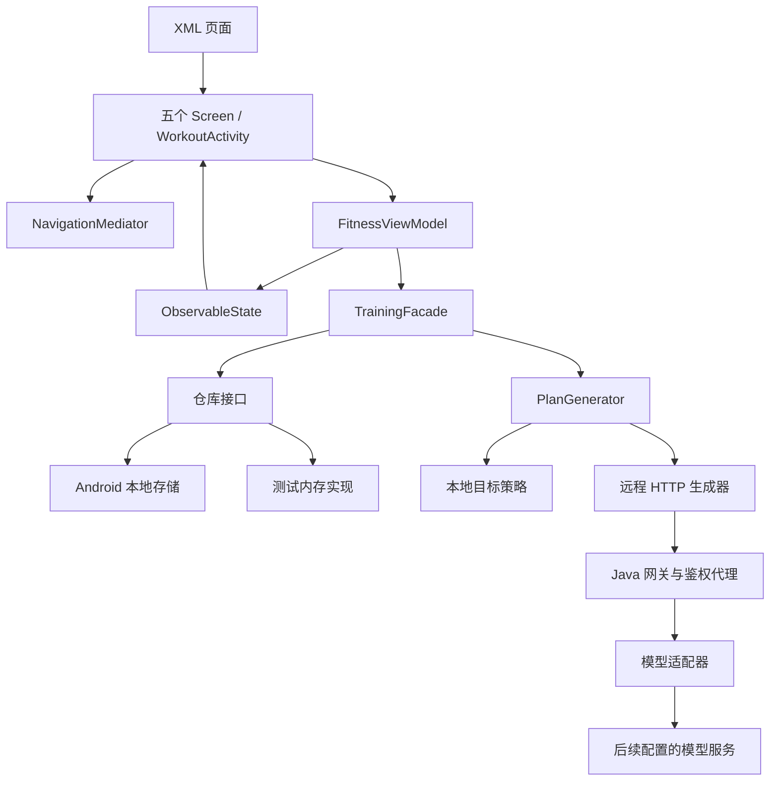

# 架构

`core` 不依赖 Android，只依赖 Gson 做边界映射。`app` 实现 Android 仓库、加密令牌、ViewModel、导航、XML 页面。`server` 独立实现网关和模型适配；用 `-PserverOnly=true` 可在无 Android SDK 的机器上构建。

依赖由 AppContainer 组装，领域类接收接口，不访问全局容器。所有业务源代码为 Java，`.gradle.kts` 仅为构建配置。

生成流程固定为“档案校验 → 生成候选 → 计划校验 → 确认请求版本 → 保存”。修改档案、撤销或清空数据会使旧计划失效；异步旧响应不能覆盖新状态。

周计划是周一至周日的模板，复制周期不是系统日历预约。训练组数由用户手动确认，休息按秒计时。热身、放松分别建议 4 分钟，手动确认进入下一阶段。离开训练页自动暂停保存，记录按会话 ID 去重。

档案、计划、收藏、训练记录及快照保存在应用私有 SharedPreferences，仓库接口可以扩展为数据库或远程实现。访问令牌使用 Android Keystore 加密；云备份和设备迁移关闭。网关不保存个人档案或模型报文，调用上游前移除昵称、性别。

登录入口由 LoginActivity（XML 界面）→ LoginViewModel（登录意图）→ DemoPhoneAuth（纯 Java 验证规则）与 LocalSessionStore（本机身份存储）组成。演示验证码不发送短信，只保留在内存；旋转界面保留输入与倒计时。演示身份与游客共用本机训练资料，不作为生产认证或多账号数据隔离。

1.2.0 的手机号登录通过 PhoneLoginGateway 隔离本机与服务端实现。LoginViewModel 在后台执行请求、在主线程发布 ObservableState，Activity 只在可见生命周期订阅；旋转通过保留普通 ViewModel 对象继续在途操作。服务端通过 DemoAccountService 校验有界临时验证码挑战，JdbcAccountRepository 用预编译 SQL 与事务写入 MySQL 用户和登录事件。凭据来自本机忽略文件/环境变量，不进入 APK。训练存储仍使用原有 SharedPreferences，各演示身份暂共用它们。

当前未实现生产短信账号认证、跨设备训练同步、推送、支付和动作视频内容服务。SQL 演示条目不构成真实手机号所有权或服务器授权会话。
